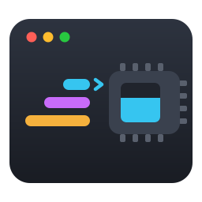

<p align="center">
  
</p>

<h1 align="center">dibs</h1>

<p align="center"><b>One GPU, many coding agents. They take turns.</b></p>

<p align="center">
  <a href="https://github.com/andrewboldi/dibs/actions/workflows/test.yml"></a>
  <a href="LICENSE"></a>
  
</p>

<p align="center">
  <a href="#what-it-adds-to-slurm">What it adds</a> ·
  <a href="#install">Install</a> ·
  <a href="#how-it-works">How it works</a> ·
  <a href="docs/caveats.md">Caveats</a> ·
  <a href="CONTRIBUTING.md">Contributing</a>
</p>

Ever had two coding agents load a model onto the same GPU at once, so one of them died out of
memory? dibs is a job queue for one Linux machine. Each agent says what a job needs (CPU cores, RAM,
GPU memory) and about how long it will take, and dibs runs it when there's room: short jobs first,
nobody starved, and anything that takes the GPU behind the queue's back is stopped. It tells Claude
Code, Codex, opencode, pi and Gemini CLI how to use it.

<p align="center">
  
</p>

## What it adds to Slurm

- **One line to install, nothing to configure.** No controller, node daemons or accounts: one
  scheduler per user, started on demand, hands out the machine it finds.
- **Agents are told, and checked.** `dibs setup` writes the rules into each agent CLI's
  instructions, and a GPU process started outside the queue is stopped within about a second, with
  a note in its output saying how to resubmit it.
- **Short jobs first, never killed at the estimate.** The estimate only orders the queue: a
  one-minute job goes ahead of a ten-minute one, nobody waits forever, and nothing is stopped for
  running long.
- **Priority with a price.** `--priority 10` gets a job ahead now; the agent's next job pays the
  time back, so always picking 10 gains nothing after the first job.
- **The rest of the machine counts.** RAM that browsers, editors and the agents themselves use isn't
  handed out: dibs measures it every second and plans with its peak over two minutes.
- **Sizing from history.** `dibs submit` shows what earlier runs of the same command used: CPUs,
  RAM, VRAM, and run time against the estimate.
- **NVIDIA and AMD.** Each job sees only its own GPUs. One that goes over its VRAM reservation may
  borrow memory nobody reserved, and is stopped only when it reaches another job's; with `--retry`
  dibs runs it again with more VRAM.

dibs stores each job's environment, which can hold API keys, in `~/.local/state/dibs`, readable only
by you. Nothing leaves the machine.

## Install

```sh
curl -fsSL https://raw.githubusercontent.com/andrewboldi/dibs/main/install.sh | bash
```

It installs [uv](https://docs.astral.sh/uv/) if you don't have it (uv brings its own Python),
installs dibs, and runs `dibs setup`: instructions for your agent CLIs, and a systemd user service
that keeps dibs and its guard running. Run it again to update; `bash -s -- --uninstall` undoes it.
Rather not pipe a script into bash? [Install by hand](docs/install-manually.md).

**Already using Slurm?** Keep it for your cluster: dibs is for the one machine your agents run on.

## How it works

One scheduler per user runs in the background and keeps the queue in SQLite; the `dibs` command
talks to it over a Unix socket. An agent submits with `dibs submit --cpus 4 --mem 16G --vram 6G
--time 20m -- python train.py`, and the job runs detached in its own systemd scope: pinned to its
cores, its RAM capped, its VRAM watched, and only its own GPUs visible. Each waiting job gets the
earliest place on a timeline where it fits for its whole estimated run, so small jobs fill gaps
without delaying anyone, and `dibs queue` says why each one waits. [More on how it
works](docs/how-it-works.md), with every command and setting.

Using another agent CLI? List its instructions file in `agent_files` in `~/.config/dibs/config.toml`,
or add it for everyone in one line ([CONTRIBUTING.md](CONTRIBUTING.md)).

## License

MIT. Built on systemd scopes, NVML and amd-smi.
